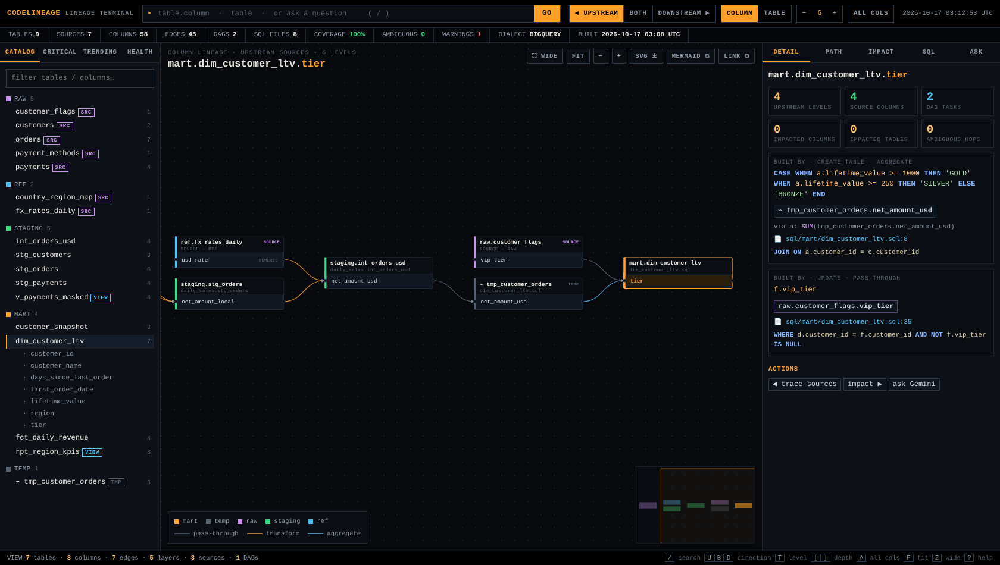
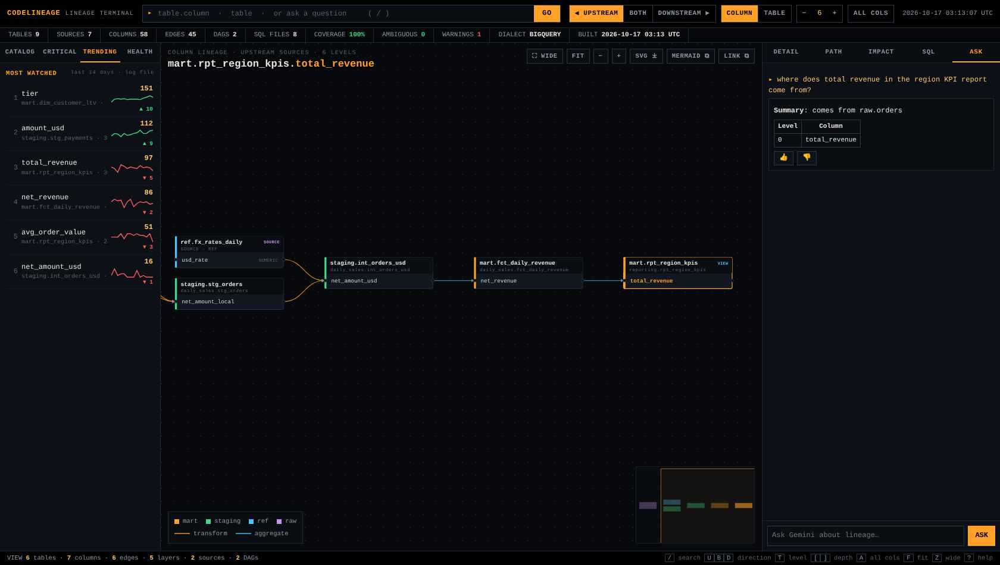
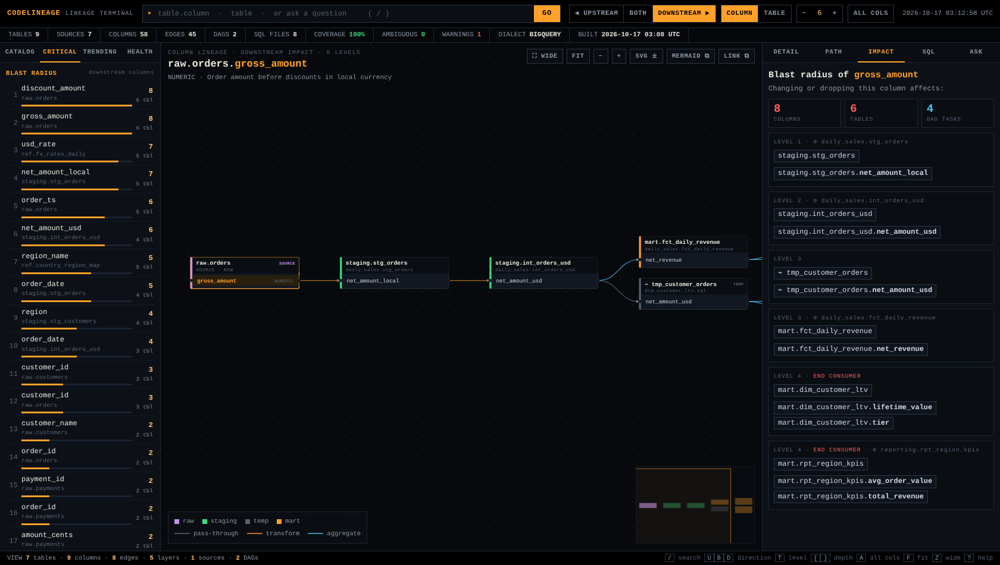

# CodeLineage

Ask in plain English *"where does `net_revenue` in `fct_daily_revenue` come from?"* and get a
**multi-level, column-level lineage** answer, traced through your SQL files, Airflow DAGs and config
files, explained by **Gemini**.

Built for this toolset: **VS Code + Gemini Code Assist + Gemini models** (Gemini API or Vertex AI).
No other LLM or SaaS lineage product is needed.

```
mart.rpt_region_kpis.total_revenue
└─ mart.fct_daily_revenue.net_revenue
      ⤷ SUM(fct_daily_revenue.net_revenue)  [sql/mart/rpt_region_kpis.sql:1 | dag=reporting task=rpt_region_kpis]
   └─ staging.int_orders_usd.net_amount_usd
         ⤷ SUM(orders_enriched.net_amount_usd)  [sql/mart/fct_daily_revenue.sql:1 | dag=daily_sales task=fct_daily_revenue]
           via orders_enriched: o.net_amount_usd
      ├─ ref.fx_rates_daily.usd_rate  ◆ SOURCE
      │     ⤷ ROUND(so.net_amount_local * fx.usd_rate, 2)  [sql/intermediate/int_orders_usd.sql:2 | dag=daily_sales task=int_orders_usd]
      └─ staging.stg_orders.net_amount_local
            ⤷ ROUND(so.net_amount_local * fx.usd_rate, 2)  [sql/intermediate/int_orders_usd.sql:2 | dag=daily_sales task=int_orders_usd]
         ├─ raw.orders.gross_amount  ◆ SOURCE
         └─ raw.orders.discount_amount  ◆ SOURCE
```

## The Lineage Terminal

An interactive, Bloomberg-style lineage explorer. It's one self-contained HTML file: no CDN, no
install, works on a locked-down network.



```bash
codelineage --repo /path/to/sql-repo explore --out lineage.html   # static file, share it anywhere
codelineage --repo /path/to/sql-repo web                          # served: + Gemini chat, trending
```

In VS Code: run `codelineage web`, then **Simple Browser: Show** → `http://127.0.0.1:8765`. Set
`CODELINEAGE_EXPLORER_URL=http://127.0.0.1:8765` and every Gemini Code Assist lineage answer
includes an "Open interactive lineage" link that jumps straight to the column.

| Panel | What it shows |
|---|---|
| **Command line** (`/`) | Fuzzy autocomplete over every table/column; anything else is sent to Gemini as a question, and the graph follows the answer |
| **Canvas** | Column-level graph laid out source → target, tables as cards coloured by layer, edges coloured by what happens (pass-through · transform · aggregate · conditional · ⚠ ambiguous). Hover a column to light up its whole chain with animated flow; hover an edge for the exact SQL expression, CTE steps, file:line and DAG task |
| **Modes** | Upstream / downstream / both (`U` `D` `B`), column ↔ table level (`T`), depth (`[` `]`), all columns (`A`), wide canvas (`Z`), minimap, zoom/pan |
| **DETAIL** | Type, description, KPI tiles (levels to source, source columns, DAG tasks, impacted columns/tables, ambiguous hops), each statement that builds the column with highlighted SQL, inputs, filters/joins, DAG, schedule |
| **PATH** | Level-by-level lineage table (the same structure the LLM answers with) |
| **IMPACT** | Blast radius: every downstream column and table by level, end consumers flagged |
| **SQL** | The actual file, statement highlighted |
| **ASK** | Gemini chat with 👍/👎 (served mode) |
| **CATALOG · CRITICAL · TRENDING · HEALTH** | Tables by layer · columns ranked by blast radius and lineage depth · most-looked-up columns with 14-day sparklines (from the usage log) · coverage %, ambiguous edges, build warnings |
| **Ticker** | Repo-wide key figures: tables, sources, columns, edges, DAGs, coverage, warnings, graph build time |
| **Export** | SVG download, copy as Mermaid, copy a deep link (`#f=table.column&d=up&n=6`) |

| Ask Gemini, the graph follows | Downstream blast radius |
|---|---|
|  |  |

## Why it's built this way

Pasting hundreds of SQL files into an LLM and asking it to trace lineage gives answers that sound
right but often aren't: it misses CTE hops, mixes up aliases, and makes up tables. So the work is
split in two:

| Layer | Who does it | What it does |
|---|---|---|
| **1. Parse (deterministic)** | `sqlglot` + Python `ast` | Renders Jinja/Airflow templates using your config files, parses every SQL statement (CTAS, INSERT…SELECT, MERGE, views), resolves CTEs/subqueries/aliases down to physical columns, and maps SQL files to DAG tasks. Writes `.lineage/graph.json`. |
| **2. Graph tools** | `codelineage.tools` | `trace_column_lineage` (upstream sources / downstream impact, N levels), `trace_table_lineage`, `describe_table`, `find_columns`, `read_sql_file`. |
| **3. Explain (LLM)** | Gemini | Works out which table/column the user means, calls the tools, and explains each level in business language with the filters, joins, DAG and schedule. |

Every hop in an answer points back to a file, line and Airflow task, so users can check it.

```
 SQL repo ──► builder ──► graph.json ──► tools ──┬──► MCP server ──► Gemini Code Assist (VS Code chat)
 (sql, dags,   (sqlglot,                         ├──► Gemini CLI
  config)       jinja, ast)                      └──► Gemini API/Vertex chat ──► CLI  /  web chat window
```

## Quick start (sample repo)

```bash
pip install -e ".[dev]"
python -m codelineage --repo examples/sample_repo build
python -m codelineage --repo examples/sample_repo trace rpt_region_kpis avg_order_value
python -m codelineage --repo examples/sample_repo trace raw.orders discount_amount --down   # impact
pytest
```

## Three ways for employees to ask questions

### A. Gemini Code Assist chat in VS Code (recommended)

Gemini Code Assist **agent mode** can call MCP servers configured in `.gemini/settings.json`
(project) or `~/.gemini/settings.json` (user). This is the same config format Gemini CLI uses.

1. `pip install` this package into the Python environment VS Code uses.
2. Copy `examples/sample_repo/.gemini/settings.json` and `GEMINI.md` into the root of your SQL repo.
   Set `CODELINEAGE_REPO` to an absolute path if VS Code isn't opened at the repo root.
3. Open the Gemini Code Assist chat, switch on **Agent** mode, and ask:
   *"Where does avg_order_value in rpt_region_kpis come from? Show all levels."*

Gemini calls `trace_column_lineage` and answers with a level-by-level table and a mermaid diagram.
If your admin has turned off agent mode or MCP, use B or C. They use the same tools.

### B. Terminal chat (Gemini API or Vertex AI)

```bash
# Vertex AI (usual inside a company)
export GOOGLE_GENAI_USE_VERTEXAI=true GOOGLE_CLOUD_PROJECT=my-proj GOOGLE_CLOUD_LOCATION=global
gcloud auth application-default login       # your Google account

export CODELINEAGE_MODEL=gemini-3.8-flash   # the default; see docs/DEPLOYMENT.md for model choice
python -m codelineage --repo /path/to/sql-repo chat
python -m codelineage --repo /path/to/sql-repo chat "what breaks if I drop raw.orders.discount_amount?"
```

### C. Lineage Terminal in the browser (or VS Code Simple Browser)

```bash
python -m codelineage --repo /path/to/sql-repo web --port 8765   # http://127.0.0.1:8765
```

The interactive graph plus a Gemini chat panel (see above). It runs on each user's own machine
(localhost only) with their own Google credentials. See [docs/DEPLOYMENT.md](docs/DEPLOYMENT.md)
for setup, IAM roles and which Gemini model to use.

## Sharing through Cloud Storage

The only Google Cloud services used are **Gemini (Vertex AI), BigQuery and Cloud Storage**. A
maintainer builds and publishes; everyone else reads the published graph, with no clone of the SQL
repo:

```bash
codelineage --repo . publish gs://acme-lineage/prod --build      # maintainer, after merges
export CODELINEAGE_GRAPH=gs://acme-lineage/prod/graph.json         # everyone (MCP, chat, web)
```

## Usage analytics (BigQuery)

Every question, answer, tool call and 👍/👎 can be logged to a BigQuery table:

```bash
codelineage bq-init my-proj.codelineage.interactions
export CODELINEAGE_BQ_TABLE=my-proj.codelineage.interactions
```

See [docs/TELEMETRY.md](docs/TELEMETRY.md) for the schema, what each surface can capture (the
Gemini Code Assist path logs tool calls only), and ready-made analysis queries.

## Pointing it at your repo

Add a `lineage.yaml` at the root of your SQL repo (see `examples/sample_repo/lineage.yaml`):

```yaml
dialect: bigquery            # snowflake, postgres, redshift, spark, databricks, tsql, oracle, ...
sql_paths: [sql]
dag_paths: [dags]
config_paths: [config]       # YAML/JSON values available to Jinja as params.x, var.value.x, x
template_searchpath: [sql]   # where DAG sql="x.sql" /  paths are resolved
schema_files: [metadata/information_schema_columns.csv]   # INFORMATION_SCHEMA.COLUMNS export, or:
schema_bigquery: [my-proj.region-us]   # read INFORMATION_SCHEMA straight from BigQuery
exclude: ["sql/scratch/*"]
drop_catalog: true           # project.dataset.table == dataset.table
variables: { ds: "2024-01-01" }
```

Then run `codelineage build`. Read the warnings it prints: they list files it couldn't parse and DAG
SQL references it couldn't resolve. Fix those by adding variables or paths.

**Keeping it fresh:** after SQL changes are merged, run `codelineage publish gs://… --build`
(see [Sharing through Cloud Storage](#sharing-through-cloud-storage)). The MCP server and chat only
read the graph, so answers come back fast, and the ticker shows which commit the graph was built from.

No database server is needed: the graph is a JSON file and usage logs go to BigQuery.
See [docs/ARCHITECTURE.md](docs/ARCHITECTURE.md) for how parsing and storage work, the graph
format, and the full complex-SQL coverage table.

## What it handles

- `CREATE [OR REPLACE] TABLE/VIEW … AS SELECT`, `INSERT INTO t (cols) SELECT …` (matched by
  position), `MERGE … WHEN MATCHED UPDATE / WHEN NOT MATCHED INSERT`, `UPDATE … SET … FROM`
- Multi-statement scripts, TEMP tables (scoped per file), stored procedures and `BEGIN/IF/LOOP`
  blocks (DML inside is recovered), one bad statement never loses the rest of the file
- CTEs, nested/scalar subqueries, aliases, `UNION`, `CASE`, window functions, `QUALIFY`, `UNNEST`,
  `SELECT *` / `* EXCEPT` (expanded from INFORMATION_SCHEMA or tables built in the repo)
- **INFORMATION_SCHEMA**: resolves unqualified columns in joins (otherwise flagged ⚠ AMBIGUOUS),
  adds column types/descriptions to answers, and warns about SQL that references missing columns
- Jinja / Airflow templating (`{{ params.x }}`, `{{ var.value.x }}`, `{{ ds }}`, ``)
- Airflow DAGs read statically, never imported: `sql=` / `query=` / `BigQueryInsertJobOperator`
  `configuration.query.query`, file references or inline SQL, DAG id, schedule, task dependencies
- Upstream ("where from") and downstream ("impact") traces, filters/joins per hop, and columns with
  no source (`COUNT(*)`, constants) flagged as such

**Not covered (yet):** SQL assembled at runtime in Python (f-strings), stored procedures and dynamic
`EXECUTE IMMEDIATE`, and transforms that happen outside SQL (Spark/pandas). These show up in the
build warnings or appear as tables with no upstream. Ideas for next steps: SQLite/BigQuery storage
with incremental rebuilds for very large repos, and dbt `manifest.json` ingestion.

## Layout

```
codelineage/
  config.py        lineage.yaml loader
  schema.py        INFORMATION_SCHEMA export loader
  templating.py    Jinja/Airflow rendering with config values
  dag_parser.py    Airflow DAG → SQL task mapping (ast)
  sql_parser.py    sqlglot column-level lineage per statement
  builder.py       crawl repo → graph.json
  graph.py         graph storage, fuzzy lookup, multi-level trace, text/mermaid rendering
  tools.py         LLM tools + system prompt
  gemini_chat.py   Gemini (google-genai) chat with automatic function calling
  mcp_server.py    MCP server for Gemini Code Assist / Gemini CLI
  explorer.py      renders the Lineage Terminal (static file or served)
  static/explorer.html  the Lineage Terminal UI (vanilla JS + SVG, no dependencies)
  web.py           serves the Lineage Terminal + chat, SQL, trending APIs
  gcs.py           publish to / read from Cloud Storage (cached locally)
  telemetry.py     prompt/answer/tool-call logging to BigQuery and/or JSONL
examples/sample_repo/   SQL + DAGs + config used by the tests
```
